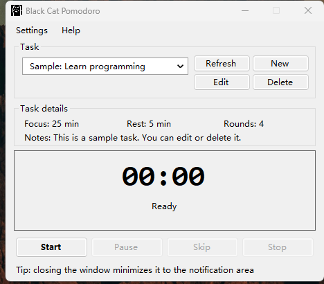
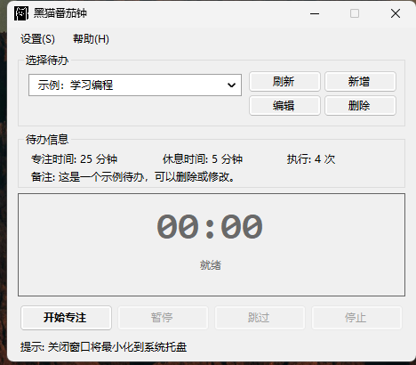

# Black Cat Pomodoro

[简体中文](README.md) | [English](README.en.md)

[](https://github.com/Fin1995/black-cat-pomodoro/actions/workflows/build.yml)

A small Windows desktop Pomodoro timer built with C# and WinForms (.NET Framework 4.7.2). It combines a focus/rest timer with task management, tray support, themes, and optional audio cues.



## Features

| Feature | Description |
|---|---|
| Pomodoro timer | Focus and rest phases with configurable minutes and repeat count |
| Task management | Add, edit, and delete tasks with notes |
| Tray support | Closing the window keeps the timer running in the notification area |
| Notifications | Tray balloon or in-app toast |
| Sound | System notification, custom WAV/MP3, or silent |
| Themes | Default and dark |
| Local data | XML storage in `%LOCALAPPDATA%`, atomic save, automatic backup |
| Single instance | Only one copy runs at a time |
| High DPI | Per-monitor V2 manifest and DPI-aware layout |
| Fonts | Separate interface and countdown fonts, with reset to defaults |
| Language | Simplified Chinese by default; switch to English at runtime |
| Built-in tests | Test toast, tray balloon, sound, and completion notification |

## Screenshots

The screenshots use the default theme. English and Simplified Chinese are shown.

| English | 简体中文 |
|---|---|
|  |  |

## Requirements

- Windows 10 or Windows 11 (x64)
- .NET Framework 4.7.2 or later (Windows 10/11 includes 4.8)
- For building: .NET SDK 8.0+ or Visual Studio 2022

## Download

Download the latest binary from [GitHub Releases](https://github.com/Fin1995/black-cat-pomodoro/releases).

The release zip contains the application and its dependencies. No installer is required.

## Build

```powershell
dotnet build BlackCatPomodoro.sln -c Release
dotnet test BlackCatPomodoro.sln -c Release
```

The application is written to:

```text
src/BlackCatPomodoro/bin/Release/net472/BlackCatPomodoro.exe
```

You can also open `BlackCatPomodoro.sln` in Visual Studio 2022.

## Usage

1. Add a task with **New** (新增).
2. Select the task and click **Start** (开始专注).
3. Use **Pause** (暂停), **Skip** (跳过), or **Stop** (停止) as needed.
4. Closing the window hides the app to the notification area. Use the tray menu to restore or exit.
5. Open **Settings** to change the theme, interface font, timer font, language, sound, notification style, or run the built-in tests.

## Data and privacy

- Tasks: `%LOCALAPPDATA%\BlackCatPomodoro\tasks.xml`
- Backup: `%LOCALAPPDATA%\BlackCatPomodoro\tasks.xml.bak`
- Corrupt files are copied to `tasks.corrupt-YYYYMMDD-HHMMSS.xml` before the app continues.
- The app has no network access, telemetry, or cloud sync.

## Project structure

```text
BlackCatPomodoro.sln
src/BlackCatPomodoro/
  Program.cs                 Application entry point and single-instance guard
  MainForm.cs                Main window, tray, preferences
  PomodoroService.cs         Wall-clock Pomodoro state machine
  DataService.cs             Atomic XML persistence
  AudioService.cs            NAudio playback with system-sound fallback
  ThemeService.cs            Default and dark themes
  Localization.cs            English/Chinese string table
  FontHelper.cs              Recursive font application
  TaskEditForm.cs            Task editor
  ToastForm.cs               In-app notification
  Resources/app.ico          Application icon
  app.manifest               DPI awareness and OS compatibility
tests/BlackCatPomodoro.Tests/
  PomodoroServiceTests.cs
  DataServiceTests.cs
  LocalizationTests.cs
docs/images/                 README screenshots
```

## Design notes

- `PomodoroService` does not own a timer. The UI calls `Update(DateTime.UtcNow)` every 250 ms, and the service compares the current time with the phase deadline. This keeps the countdown accurate when the UI is busy or the machine sleeps.
- `DataService` writes to a temporary file and swaps it in with `File.Replace`, keeping the previous file as `tasks.xml.bak`.
- `AudioService` uses NAudio for WAV/MP3 playback. If the NAudio assemblies are missing at runtime, it falls back to the Windows notification sound.
- `FontHelper` applies the interface font to the form, child controls, and tool strip items; the countdown uses a separate timer font. The two areas can be configured independently.
- `Localization` is a small runtime string table. Simplified Chinese is the default; the language can be switched without restarting.
- The built-in **Test** menu exercises the toast, tray balloon, sound, and completion notification paths.
- Unhandled UI exceptions are written to `%TEMP%\BlackCatPomodoro-crash.log`.
- The application is a single instance. Starting it twice shows a message instead of opening a second timer.

## Troubleshooting

| Problem | What to check |
|---|---|
| No sound | Confirm `NAudio.dll` and its dependencies are next to the executable; otherwise the app uses system sounds. Check the Windows sound mixer. |
| Custom sound falls back to the system sound | The player detects the actual content; a valid WAV/MP3 should play, including an MP3 named `.wav`. |
| Window position | The window centers on the screen containing the mouse pointer at startup. |
| Sample task language | The app-provided sample is translated when the language changes; edited tasks are left alone. |
| Blurry UI on a high-DPI display | The app is PerMonitorV2 aware. Restart it after changing display scaling. |
| Tasks disappeared | Check `tasks.xml.bak` and `tasks.corrupt-*.xml` in `%LOCALAPPDATA%\BlackCatPomodoro`. |
| App crashed | Check `%TEMP%\BlackCatPomodoro-crash.log` for the exception and stack trace. |
| App will not start twice | This is intentional: only one instance is allowed. |

## Contributing

Issues and pull requests are welcome. Run the test suite before submitting a change:

```powershell
dotnet test BlackCatPomodoro.sln -c Release
```

## License

MIT. See [LICENSE](LICENSE).

Copyright (c) 2026 Fin1995.
